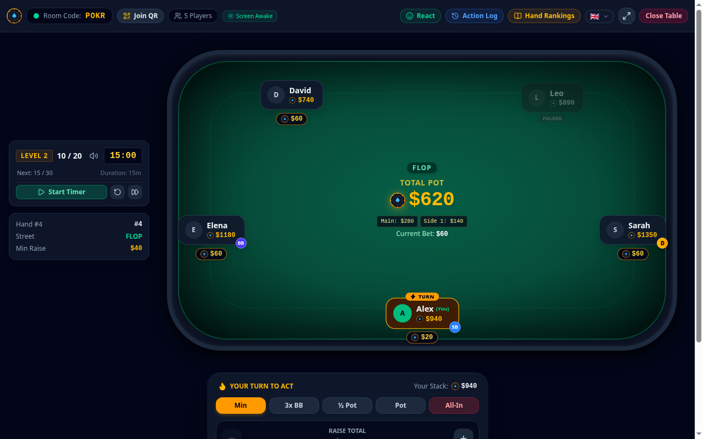
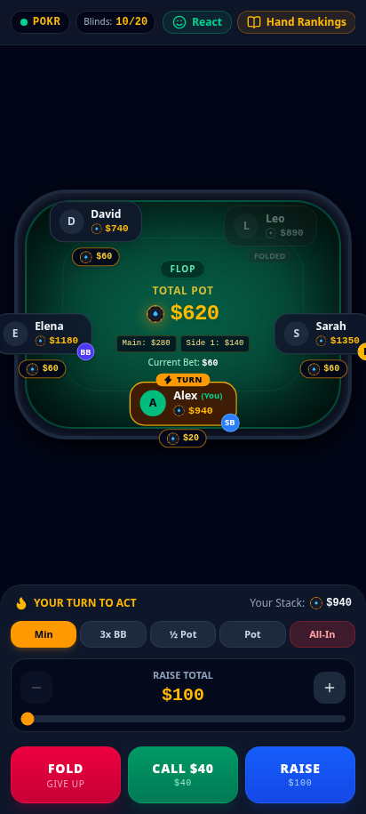
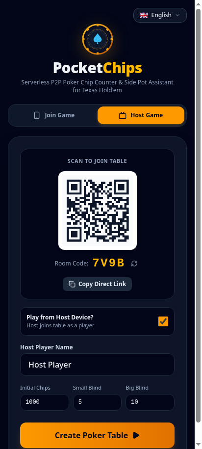

# PocketChips ♠️🪙
### Serverless P2P Poker Chip Counter & Betting Assistant

**PocketChips** is a mobile-first, serverless Progressive Web App (PWA) designed for home Texas Hold'em poker games. 
- **Physical cards are dealt by players in real life.** The app never handles cards, hole cards, or hands.
- **The app handles everything else:** digital chip stacks, blinds automation, turns/action timers, side pots, all-in calculations, showdown winner payouts, and re-buys.
- **100% Serverless:** Runs directly in the browser and connects via Peer-to-Peer (P2P) WebRTC DataChannels using `peerjs`. Can be hosted 100% statically on GitHub Pages with zero backend server.

---

## 📸 Screenshots

<p align="center">
  
</p>
<p align="center">
  <em>Interactive Table / TV Mode — digital chips, blinds clock, multi-tier side pots & live action tracking</em>
</p>

<br />

<p align="center">
  
  &nbsp;&nbsp;&nbsp;&nbsp;&nbsp;&nbsp;&nbsp;&nbsp;
  
</p>
<p align="center">
  <em>Mobile-First Player Action Controls & Instant QR Code Room Lobby</em>
</p>

---

## 🚀 Key Features

- **📱 Mobile-First Ergonomics:** Thumb-friendly drawer for Fold (Red), Check/Call (Green), Bet/Raise (Blue) with quick presets (`Min Raise`, `3x BB`, `½ Pot`, `Pot`, `All-In`) and a smooth slider.
- **🌐 Star-Topology P2P WebRTC:** 
  - Host creates a room with a random 4-letter code (`ROOM_ID = "POKER-" + code`).
  - Players join instantly by scanning a QR code or entering the 4-letter room code.
  - Host device acts as the table authority and broadcasts snapshots to all connected peers.
  - Automatic reconnection & heartbeat so a phone sleeping or refreshing reconnects seamlessly with existing chips and seat preserved.
- **🚪 Host Waiting Lobby (`HOST_LOBBY`):**
  - Host stays in an interactive waiting lobby before the game begins.
  - Displays a large QR code and room code while waiting for players to join in real time.
  - Allows adjusting player seating order, removing unwanted players, and reviewing stakes before dealing Hand #1.
- **🃏 Dealer Card Instructions & Street Announcements:**
  - Automated physical card dealing instructions for each street (Preflop, Flop, Turn, River, Showdown).
  - Explicit instructions for the Dealer (e.g. "Burn 1 card, then deal 3 community cards face-up in the center").
  - Visual and audio chimes table-wide when a new street begins.
- **🧮 Pure Poker Domain Engine (`src/lib/engine/poker.ts`):**
  - Small & Big Blind auto-posting with Heads-Up (2-player) and full ring (3–10 players) support.
  - Strict minimum raise validation (`raiseDelta >= minRaise`).
  - Incremental multi-tier side pot calculations for multiple all-in players of different stack sizes.
  - Immediate pot award shortcut if only 1 unfolded player remains.
  - **Seat Reordering & Automatic Round Restart:** Host can reorder player seating order (using quick Move Up `↑` and Move Down `↓` steppers) to match physical seating; if players are reordered mid-hand, the hand automatically restarts and re-posts the blinds cleanly according to the new positions.
- **🏆 Interactive Showdown Resolution:**
  - Sequential resolution of Main Pot and Side Pots.
  - Host taps winning player(s) among eligible contributors.
  - Even split distribution with odd remainder chips awarded to winning player(s) closest to the dealer's left.
  - Celebratory confetti burst on payout.
  - **Hand Rankings Cheat Sheet:** Quick access to the complete 10-tier poker hand values guide right inside the showdown modal.
- **📖 In-Game Poker Hand Rankings Guide:**
  - Dedicated **Hands** / Info button accessible at all times during the game from the top navigation bar.
  - Shows all 10 hands (Royal Flush to High Card) with visual playing cards, suits, descriptions, and tie-breaking rules.
- **📺 Host / TV Display Mode (`?view=table`):**
  - Optimized for casting to a TV or placing a tablet in the center of the poker table.
  - Large pot readout, side-pot tier breakdown, dealer button tracking, and blind countdown timer.
  - Host controls: "Undo Last Action", "Re-buy Player (+500 / +1k)", "Force Fold", "Sit Out / Return", and Stakes editor.
- **🔔 Haptics & Synthesized Web Audio:**
  - Soft chip click sounds, check knocks, fold sounds, win fanfares, dealing chimes, and blind increase horns synthesized using Web Audio API (zero audio files needed).
  - Mobile vibration pulses on your turn (`navigator.vibrate([100, 50, 100])`).
- **🍪 Cookie & LocalStorage Session Persistence:**
  - Stores room code, role, and player identities in cookies, with full state snapshots in `localStorage`.
  - Accidental page reload or phone sleep restores active table, chip counts, and reconnects without losing progress.

---

## 🛠️ Tech Stack

- **Framework:** React 19 + TypeScript + Vite
- **Styling:** Tailwind CSS v4 with custom felt and chip styling
- **P2P Networking:** `peerjs` (ephemeral cloud broker for WebRTC DataChannel signaling)
- **QR Codes:** `qrcode`
- **Audio / Haptics:** Web Audio API + HTML5 Vibration API
- **Icons:** `lucide-react`
- **Testing:** `vitest`

---

## 🧪 Running Unit Tests

PocketChips includes a complete test suite covering blind posting, heads-up rules, raise validation, side pot tiers, odd-chip distribution, and undo:

```bash
npm test
```

---

## 💻 Local Development

1. **Install dependencies:**
   ```bash
   npm install
   ```

2. **Start local dev server:**
   ```bash
   npm run dev
   ```

3. **Build production bundle:**
   ```bash
   npm run build
   ```

---

## 🌐 Deploying to GitHub Pages

1. Push this repository to GitHub.
2. In your GitHub repository settings:
   - Go to **Settings** -> **Pages**.
   - Under **Build and deployment** -> **Source**, select **GitHub Actions**.
3. Push to `main` branch. The included GitHub Action workflow (`.github/workflows/deploy.yml`) will automatically build, test, and deploy to:
   `https://<username>.github.io/<repository-name>/`

